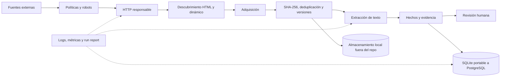

# Entregable 1 — Revisión visual inicial

Este documento contiene únicamente los dos diagramas autorizados para la primera revisión. Los diagramas de flujo y secuencia se añadirán después de su aprobación.

## Diagrama de componentes

La fuente completa y regenerable está en `diagrams/entregable-1-components.mmd`. El límite principal es un monolito modular: una sola ejecución coordinada, con adaptadores sustituibles para HTTP, descubrimiento dinámico, almacenamiento y extracción. OCR queda como puerto diferido y no se activa sin confirmar que el PDF carece de capa de texto.

## ERD

La fuente autoritativa está en `diagrams/entregable-1-erd.puml` y utiliza notación crow's foot. PlantUML se eligió como fallback porque Mermaid aceptó la sintaxis pero no pudo renderizar el grafo completo en la pestaña visual. `diagrams/entregable-1-erd.mmd` queda como representación Mermaid secundaria para GitHub y futuras pruebas de compatibilidad.

Se separan el documento lógico, sus versiones y el objeto binario por hash para que una misma descarga no se duplique. Los hechos se separan de su evidencia porque un hecho puede necesitar más de una región o fragmento de respaldo. La revisión humana se modela aparte para conservar tanto el motivo de revisión como cada decisión posterior.

Restricciones de unicidad compuestas —por ejemplo, `(source_id, canonical_url)`, `(document_id, blob_sha256)` y `(run_report_id, metric_name)`— se documentarán en el modelo físico de la arquitectura completa; no se sobrecarga el diagrama visual con índices.
